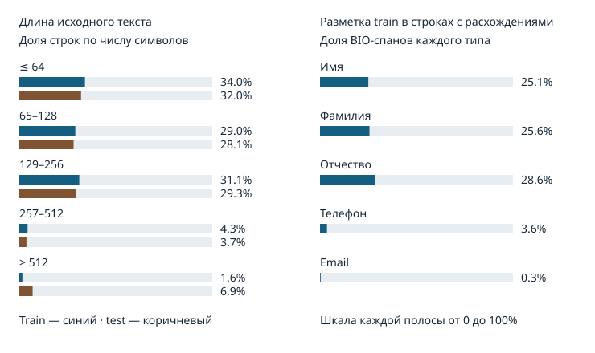

# EDA · ДЗ2

Использованы открытые русскоязычные CSV Red Mad Robot, закреплённые по ревизиям. Train и опубликованный test содержат исходный текст, список токенов и BIO-разметку. В данных смешаны синтетические и псевдонимизированные тексты, а происхождение отдельных строк в CSV не указано. [Train CSV](https://huggingface.co/datasets/redmadrobot-rnd/pii_train/resolve/1a74b9f108bf8c4a5f06c00243ad3bc5c01d6aa5/train.csv) · [Test CSV](https://huggingface.co/datasets/redmadrobot-rnd/pii_benchmark/resolve/f77ea831274daf980cc45c61a93c226be9d978d6/test.csv)

| Проверка | Train | Опубликованный test |
| --- | ---: | ---: |
| Строки | 17 137 | 2 841 |
| Без BIO-сущностей любого типа | 1 237 | 371 |
| Медиана длины в токенах разметки | 19 | 19 |
| Лишние строки после нормализации дублей | 62 | 0 |
| Расхождение `text` и `tokens` без пробельных символов | 1 429 | 2 |



- **Длина.** До 256 символов включительно содержат 94,1% строк train и 89,4% test. Для проверки задержки полезно выделить длинный хвост отдельно. [Агрегаты](pii_audit.json)
- **Границы.** BIO структурно корректна, но в строках с расхождениями находятся 25–29% размеченных частей имён, 3,6% телефонов и 0,3% email в train. По точному сопоставлению большинство изменённых имён отсутствуют в исходной строке. Ручной просмотр показал и простые замены имён, и случаи, где перенос метки дал бы ошибку. Поэтому первый прогон использует только строки с проверяемыми границами. [Агрегаты](pii_audit.json) · [Аудит спанов](train_span_audit.json) · [Ручная проверка](train_span_manual_review.md)
- **Похожие шаблоны.** Точных и нормализованных совпадений между опубликованными наборами нет. После замены размеченных сущностей их типами с train совпадают шаблоны 452 строк test. Если учитывать только шаблоны с тремя или более словесными токенами вне сущностей, остаются 255 строк. Это повод показывать качество на знакомых и новых шаблонах раздельно. [Агрегаты](pii_audit.json)

## Первый прогон правил на CPU

На групповой валидации из train 3 226 строк. Для телефонов precision и recall по точным границам составили 97,4% и 55,6%. У правила для email без внутренних пробелов нулевая полнота. Во всех 329 размеченных адресах в этой валидации есть пробельные символы внутри спана. Имена оставлены для обучаемой модели. Опубликованный test использован только для аудита данных. [Лог B0](rule_baseline.json)

## Внешняя проверка контактных правил

Прогнали тот же B0 на двух частях синтетического PII-Bench. `domain` смешивает типы ПДн и содержит тексты без размеченных ПДн. В `entity` примеры подобраны по отдельным типам. [Описание бенчмарка](https://arxiv.org/pdf/2605.05277#page=20) · [Лог внешнего прогона](rule_baseline_external.json)

| Часть | Email, точных совпадений / эталонных | Телефон, точных совпадений / эталонных | Строки с пропущенным контактом | Строки с маской вне всех размеченных ПДн |
| --- | ---: | ---: | ---: | ---: |
| `domain` (900 строк) | 102 / 103 | 147 / 147 | 1 | 1 |
| `entity` (910 строк) | 70 / 70 | 58 / 70 | 12 | 0 |

В сценарной части все размеченные email записаны слитно. Сравнение с Red Mad Robot показывает, насколько важен формат входа для одного и того же правила. В части `entity` в четырёх строках маски затронули ПДн других типов за границами эталонных контактов. Ни одна маска в этой части не вышла за пределы всей разметки ПДн. [Лог внешнего прогона](rule_baseline_external.json)

## Воспроизведение

Сохраните закреплённые CSV по ссылкам выше в `data/raw/train.csv` и `data/raw/test.csv`. Скриптам достаточно Python 3.11 и стандартной библиотеки.

```bash
python scripts/audit_pii.py data/raw/train.csv data/raw/test.csv > docs/pii_audit.json
python scripts/audit_train_spans.py data/raw/train.csv > docs/train_span_audit.json
python scripts/plot_eda.py docs/pii_audit.json docs/eda.svg
PYTHONPATH=src python scripts/evaluate_rules.py data/raw/train.csv > docs/rule_baseline.json
```

Внешний прогон проверен на Python 3.12 с PyArrow 21.0.0 и NumPy 2.2.6. Поместите оба файла из каталога `data/` закреплённой ревизии PII-Bench в `data/raw/`. [Parquet PII-Bench](https://huggingface.co/datasets/hivetrace/pii-bench/tree/cd6a18ace16daf23e79247ccf1e2b245d4054654/data)

```bash
python -m pip install "pyarrow==21.0.0" "numpy==2.2.6"
PYTHONPATH=src python scripts/evaluate_external_rules.py \
  data/raw/domain-00000-of-00001.parquet data/raw/entity-00000-of-00001.parquet \
  > docs/rule_baseline_external.json
```
