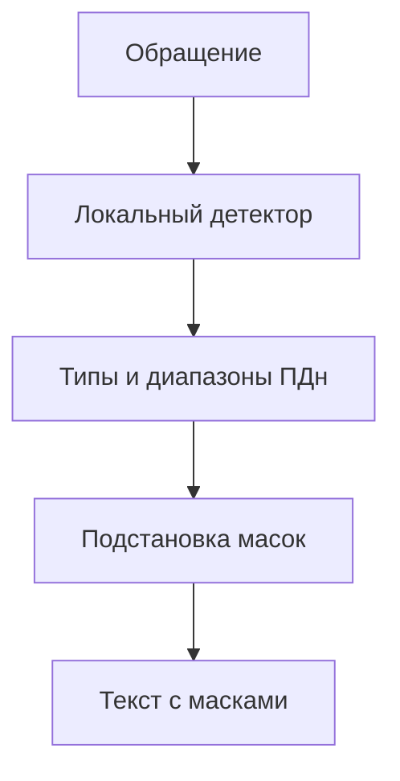
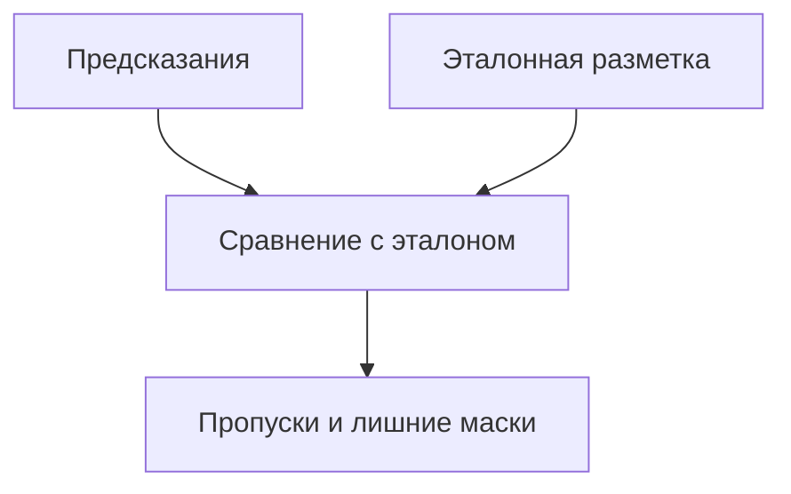

# PIIMask — маскирование ПДн в обращениях поддержки

Татьяненко Алексей Дмитриевич · ИТМО, AI Talent Hub · ДЗ1

## 1. Цели и предпосылки

### 1.1. Зачем нужен продукт

Оператор поддержки хочет получать краткие резюме обращений через внешнюю LLM. Перед отправкой он может скрыть контакты вручную. PIIMask должен сократить эту работу. Например, в жалобе на недоставку стоит скрыть email и сохранить номер заказа и описание проблемы.

**Экономика пилота.** Предлагаем сравнить на одной партии время ручного маскирования со временем проверки и исправления результата PIIMask. Обработку на CPU замерим отдельно. При сопоставимом качестве денежный эффект — стоимость сэкономленного времени сотрудника за вычетом затрат на CPU. Разработка учитывается отдельно. Для расчёта окупаемости ещё нужны фактический поток обращений и ставки заказчика.

### 1.2. Бизнес-требования и ограничения

| Требование | Проверка |
| --- | --- |
| Скрывать имена, телефоны и email | Сравнить результат с разметкой, отдельно проверить неполные маски |
| Сохранять остальной текст | Проверить, что вне возвращённых диапазонов текст сохранён. По разметке выявить лишние маски |
| Обрабатывать обращения локально на CPU | Запустить офлайн, измерить задержку обработки |

Первый пилот пройдёт на размеченных текстах без отправки во внешнюю LLM. На отложенных данных проверим, сокращает ли добавление детектора имён пропуски при приемлемой доле лишних масок. Допустимые уровни пропусков и лишних масок зададим до итогового теста. Качество резюме оценим отдельно.

### 1.3. Скоуп первой итерации

**Входит.** Одно короткое русскоязычное обращение на входе. На выходе — типы, символьные диапазоны и текст с масками. Результат итерации — локальный прототип и отчёт об офлайн-проверке.

**За рамками.** Адреса и реквизиты, обратная подстановка и хранение соответствий, вложения и цепочки сообщений, интеграция с внешней LLM, автоматическое исправление детектора агентом.

### 1.4. Предпосылки решения

Есть открытые размеченные наборы Red Mad Robot. Аудит выявил расхождения между исходным текстом и токенами разметки, а также общие шаблоны между опубликованными выборками. Качество на потоке конкретной службы поддержки предстоит измерить.

## 2. Методология

### 2.1. Постановка задачи

Детектор извлекает из строки диапазоны `[start, end)` и типы `PERSON`, `PHONE`, `EMAIL`. Для телефонов и email проверим правила, для имён — помогает ли модель, учитывающая контекст.

Результат правил сравним с правилами, дополненными детектором имён. Коммерческий аналог маскирования — HiveTrace DataClean. [HiveTrace DataClean](https://hivetrace.ru/)

### 2.2. Блок-схема

**Маскирование одного обращения**

| Шаг | Пример |
| --- | --- |
| Вход | `Анна Иванова, заказ A-42 не приехал.` |
| Детектор | `PERSON [0, 12)` |
| Выход | `[PERSON], заказ A-42 не приехал.` |

**Офлайн-оценка**

В том же обращении эталонный спан — `Анна Иванова`. В обоих примерах ниже границы предсказания отличаются от эталона.

| Текст после подстановки | Что покажет оценка |
| --- | --- |
| `Анна [PERSON], заказ A-42 не приехал.` | Частичный пропуск. Имя осталось открытым. |
| `[PERSON] не приехал.` | Лишняя маска. Вместе с ФИО исчез номер заказа. |

Задержку измеряем отдельно при прогоне на CPU.
