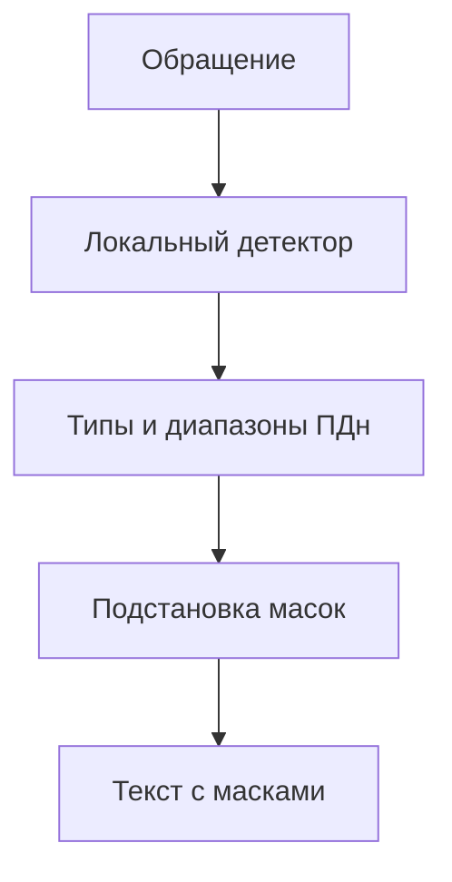
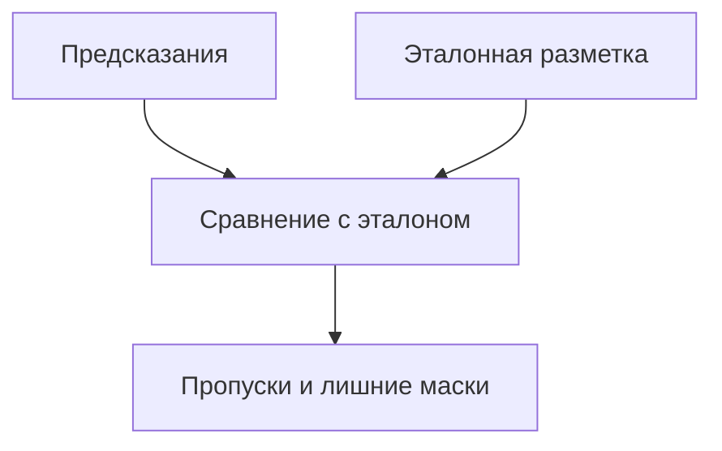

# PIIMask — маскирование ПДн в обращениях поддержки

Татьяненко Алексей Дмитриевич · ИТМО, AI Talent Hub · ДЗ1–ДЗ2

## 1. Цели и предпосылки

### 1.1. Зачем нужен продукт

Оператор поддержки хочет получать краткие резюме обращений через внешнюю LLM. Перед отправкой он может скрыть контакты вручную. PIIMask должен сократить эту работу. Например, в жалобе на недоставку стоит скрыть email и сохранить номер заказа и описание проблемы.

**Экономика пилота.** Предлагаем сравнить на одной партии время ручного маскирования со временем проверки и исправления результата PIIMask. Обработку на CPU замерим отдельно. При сопоставимом качестве денежный эффект — стоимость сэкономленного времени сотрудника за вычетом затрат на CPU. Разработка учитывается отдельно. Для расчёта окупаемости ещё нужны фактический поток обращений и ставки заказчика.

### 1.2. Бизнес-требования и ограничения

| Требование | Проверка |
| --- | --- |
| Скрывать имена, телефоны и email | Сравнить результат с разметкой, отдельно проверить неполные маски |
| Сохранять остальной текст | Проверить, что вне возвращённых диапазонов текст сохранён. По разметке выявить лишние маски |
| Обрабатывать обращения локально на CPU | Запустить офлайн, измерить задержку обработки |

Первый пилот пройдёт на размеченных текстах без отправки во внешнюю LLM. На отложенных данных проверим, сокращает ли добавление детектора имён пропуски при приемлемой доле лишних масок. Допустимые уровни пропусков и лишних масок зададим до итогового теста. Качество резюме оценим отдельно.

### 1.3. Скоуп первой итерации

**Входит.** Одно короткое русскоязычное обращение на входе. На выходе — типы, символьные диапазоны и текст с масками. Результат итерации — локальный прототип и отчёт об офлайн-проверке.

**За рамками.** Адреса и реквизиты, обратная подстановка и хранение соответствий, вложения и цепочки сообщений, интеграция с внешней LLM, автоматическое исправление детектора агентом.

### 1.4. Предпосылки решения

Есть открытые размеченные наборы Red Mad Robot. Аудит выявил расхождения между исходным текстом и токенами разметки, а также общие шаблоны между опубликованными выборками. Качество на потоке конкретной службы поддержки предстоит измерить. [EDA](eda.md)

## 2. Методология

### 2.1. Постановка задачи

Детектор извлекает из строки диапазоны `[start, end)` и типы `PERSON`, `PHONE`, `EMAIL`. Для телефонов и email проверим правила, для имён — помогает ли модель, учитывающая контекст.

Результат правил сравним с правилами, дополненными детектором имён. Коммерческий аналог маскирования — HiveTrace DataClean. [HiveTrace DataClean](https://hivetrace.ru/)

### 2.2. Блок-схема

**Маскирование одного обращения**

| Шаг | Пример |
| --- | --- |
| Вход | `Анна Иванова, заказ A-42 не приехал.` |
| Детектор | `PERSON [0, 12)` |
| Выход | `[PERSON], заказ A-42 не приехал.` |

**Офлайн-оценка**

В том же обращении эталонный спан — `Анна Иванова`. В обоих примерах ниже границы предсказания отличаются от эталона.

| Текст после подстановки | Что покажет оценка |
| --- | --- |
| `Анна [PERSON], заказ A-42 не приехал.` | Частичный пропуск. Имя осталось открытым. |
| `[PERSON] не приехал.` | Лишняя маска. Вместе с ФИО исчез номер заказа. |

Задержку измеряем отдельно при прогоне на CPU.

### 2.3. Этапы решения задачи

#### Этап 1. Подготовка данных

Используем закреплённые выгрузки Red Mad Robot. Для каждого текста CSV хранит исходную строку, токены и BIO-метки начала и продолжения сущностей. В наборах смешаны синтетические примеры и псевдонимизированные сообщения. Происхождение отдельных строк неизвестно. Сырые записи храним локально, в отчёт выносим агрегаты.

Для первого прогона берём записи, где `text` и склеенные `tokens` совпадают без учёта пробельных символов. Переносим границы BIO по позициям символов в исходном тексте. Соседние части имени объединяем в `PERSON`, если между ними только пробельные символы и подтипы не повторяются. Инициалы, дефисы и соседние имена требуют отдельной проверки. При таком отборе теряется больше размеченных частей имени, чем контактов. Перед использованием отброшенных строк нужно проверить их разметку по `text`. [Разбор расхождений](train_span_manual_review.md)

Результат этапа — версия входных CSV, воспроизводимое преобразование спанов, отчёт о потерях и разбиение. Объёма хватает для первого сравнения. Если на ошибках выявятся недопредставленные форматы, для них понадобится отдельная размеченная выборка. Её объём определим по разбросу оценки на первом прогоне.

#### Этап 2. Подготовка моделей

**Валидация.** Внутри опубликованного train объединяем строки с одинаковым нормализованным текстом или одинаковым шаблоном после замены размеченных сущностей на их типы. Группа целиком попадает либо в обучение, либо в валидацию. Так модель не получает один и тот же шаблон в обеих частях. Разбиение воспроизводится по хешу первого номера строки группы и версии разбиения. Опубликованный test оставляем для итогового прогона после выбора конфигурации. Отдельно покажем качество на знакомых и новых шаблонах. [Аудит совпадений](eda.md)

**Модели.** B0 — правила для российских номеров с префиксом и email без внутренних пробелов. Следующий вариант расширяет правила контактов и сравнивает их отдельно от детекции имён. Для имён первый обучаемый кандидат — логистическая регрессия над токенами с контекстом соседних слов и признаками регистра, формы и окончаний. Целевая переменная — BIO для `PERSON`, функция потерь — кросс-энтропия по токенам. На выходе собираем допустимые последовательности в спаны. Если границы нестабильны, проверим последовательностную модель. Готовый NER для русского даст дополнительную точку сравнения по именам.

**Метрики.** Считаем precision и recall по точному совпадению типа и границ. Для пилота дополнительно измеряем долю сообщений, где остался открытым хотя бы один символ эталонного контакта или имени, и долю сообщений, где маска скрыла символы вне всех размеченных ПДн. Частичная маска и маска с лишним текстом могут обе ошибиться по границам, но имеют разные последствия. Порог выбираем по кривой пропусков и лишних масок на валидации. Результат этапа — сравнение на одних и тех же сообщениях, конфигурация для итогового теста и разбор по длине, формату и знакомости шаблона. [Прогоны B0 и внешний тест](eda.md)

#### Этап 3. Сборка маскирования и офлайн-пилот

Объединяем спаны правил и модели и разрешаем пересечения перед подстановкой масок. На примерах проверяем границы, соседние сущности, пустой вход и сохранность текста вне масок. На отложенной партии замеряем задержку на CPU и время ручной проверки с исправлениями. Группируем пропуски и лишние маски по типу сущности и формату записи, чтобы выбрать, что исправлять в следующей итерации. Результат — локальный прогон и отчёт о качестве, задержке и трудозатратах проверки.
